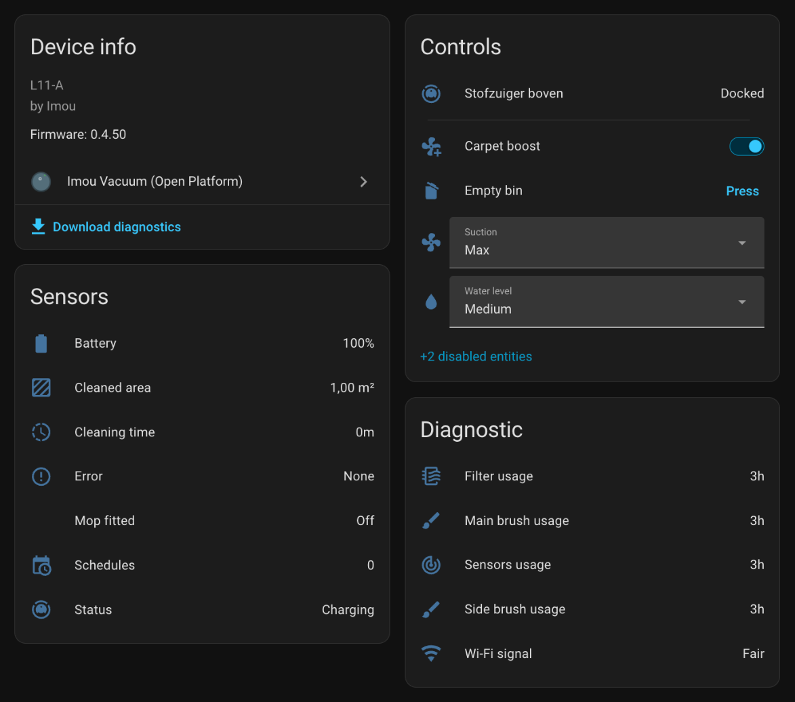

# Imou Vacuum for Home Assistant

[](https://github.com/hacs/integration)
[](https://github.com/okke-mengerink/ha-imou-robot/releases)
[](https://github.com/okke-mengerink/ha-imou-robot/actions/workflows/validate.yml)
[](https://github.com/okke-mengerink/ha-imou-robot/blob/main/LICENSE)
[](https://www.home-assistant.io/)

[](https://my.home-assistant.io/redirect/hacs_repository/?owner=okke-mengerink&repository=ha-imou-robot&category=integration)

This custom integration, **Imou Vacuum (Open Platform)**, adds your Imou robot vacuum (robot cleaner) to Home Assistant as a standard vacuum entity, with sensors for battery, status, cleaned area and cleaning time. You install it through HACS, set it up in the Home Assistant UI, and it controls the robot through the official Imou Open Platform cloud API (cloud only, with a free developer account). It is verified on the Imou RV-L11-A (L11 series, with the auto-empty dock). The Imou RV1 Pro Max and RV1L Pro are partly verified by users. Other Imou robots that use the same things-model identifiers may work, but they are unverified. Home Assistant's built-in Imou integration and the Imou Life and Imou-OpenPlatform integrations in HACS do not support robot vacuums, which is why this one exists.

> **Using this integration?** Give it a ⭐ on GitHub: stars help other Imou owners find it. Do you have another Imou robot? [Share its diagnostics](#help-us-map-other-models) so it can be supported too.

**Step-by-step guide:** [English](https://okke-mengerink.github.io/ha-imou-robot/) · [Nederlands](https://okke-mengerink.github.io/ha-imou-robot/nl/)



*The device page of an Imou RV-L11-A in Home Assistant (version 0.6.3). "Stofzuiger boven" is the name the owner gave the robot.*

## Why this integration?

- **The existing Imou integrations do not cover robot vacuums.** Home Assistant's built-in `imou` integration and the `imou_life` (Imou Life) and `Imou-OpenPlatform` integrations from HACS do not support them.
- **Official API.** It uses the Imou Open Platform cloud API with generic "things model" calls. It is cloud only: there is no local control.
- **A normal vacuum entity.** The robot shows up as a standard Home Assistant `vacuum` entity with sensors, so it works in dashboards, automations and scripts like any other robot vacuum.
- **Model-driven.** Entities are created from the robot's things model at runtime, so models that use the same identifiers can work without code changes.
- **Quota-friendly.** Polling adapts to what the robot is doing. Typical use is about 13,000 API calls per month, against 30,000 included in Imou's free tier.

## Supported devices

| Robot | Status | Notes |
|---|---|---|
| Imou RV-L11-A (L11 series, with auto-empty dock) | Verified | Imou cloud `deviceModel` `L11-A`, Home Assistant 2026.10 |
| Imou RV1 Pro Max | Reported by a user (issue #1), partly verified | Confirmed by the user: battery, return to dock, the suction levels (quiet, standard, strong, max), the water volume (off, low, medium), the schedule start time and room cleaning of the two rooms from the user's schedule. Not yet verified: room cleaning with the rooms of the cleaning order (`sequence`); one robot's diagnostics list all of its rooms there, but that this holds for every robot and that those rooms can be cleaned is not confirmed. Not yet confirmed: dock status. The robot does not report the dock status, so those entities are disabled by default (as on every model). |
| Imou RV1L Pro | Reported by a user (issue #8), partly verified | Confirmed by the user: return to dock (through `swp_backStation`), the water volume (the app shows medium and the robot reports `mop_speed` 2, which the integration shows as medium; the app's fourth level, High, is not in the things model) and carpet boost (the app and Home Assistant agree). Dock status is not supported on this model: it reports `station_status` as all zeros, also while charging, and the app has no station settings. |
| Any other Imou robot vacuum | unverified — please share diagnostics | Might work if its things model uses the same identifiers. See [Help us map other models](#help-us-map-other-models). |

Other Imou robots are mapped from their things model: the robot's own refs, the labels of its statuses, error codes and suction levels (so a model that numbers them differently still maps correctly) and alternative identifiers such as `back_station` or `swp_backStation` for return to dock. When a core function is missing (start and stop, return to dock, battery or status) or a value is not recognised, Home Assistant shows a repair notice that says what is missing or unknown and links to a GitHub issue that is already filled in with your model. Attach the diagnostics download to it and the model can be added.

Verified on a real RV-L11-A:

- Locate, start, pause, resume and return to dock.
- Suction levels quiet, standard and max (set through the `WindWater` service).
- Carpet boost.
- The empty-bin button: the dock empties the robot's bin (confirmed by the owner).
- The reset buttons: **Reset sensors** set the robot's sensor counter to 0 (tested by the owner); the other three use the same command.
- Battery and status, including "emptying bin" after a run.
- Cleaned area (m²) and cleaning time (min). A first real run of 31 m² in 34 min was tracked correctly.
- Room cleaning of one room and of two rooms in one command (`clean_control` in room mode), and reading the schedules (`clean_list`).

## Features

- **Vacuum entity:** start (a whole-house clean, or resume when paused), pause, stop, return to dock, locate, and fan speed (the suction level: quiet, standard or max; quiet, standard, strong or max on RV1 models).
- **Sensors:** battery, status, error, cleaned area (m²), cleaning time (min), consumable usage in hours (side brush, main brush, filter, sensors), Wi-Fi signal, a mop-fitted binary sensor, a charging binary sensor (RV1 models), and the dock sensors (disabled by default; no model is verified to report dock status).
- **Controls:** suction and water level selects, a water volume select (RV1 models), the carpet boost switch, the empty-bin button, **Reset** buttons for the consumables (side brush, main brush, filter, sensors), and a **Clean <room>** button for every room the integration finds. See [Entities](#entities).
- **Set up in the UI:** App ID, App Secret and region, with re-authentication when the App Secret changes. English translation. A diagnostics download for mapping new models.
- **Automatic discovery:** every robot on your Imou account is found, and only the entities its model supports are created.
- **Room cleaning (Home Assistant 2026.3 or newer):** clean one or more rooms with `vacuum.clean_area` or by voice, after mapping the robot's rooms to your Home Assistant areas. See [Room cleaning](#room-cleaning).
- **Schedules sensor:** the number of enabled schedules from the Imou app, with the details as an attribute.
- **Advanced commands:** `vacuum.send_command` calls any service of the robot's things model, checked against that model.
- **Adaptive polling:** every 300 s when idle or docked, every 30 s while active, plus a quick refresh after each command.

Not supported: the map, zone cleaning and creating, editing or switching schedules (schedules are read-only). The robot does not report its map or room list through the Imou Open Platform API. The integration is cloud only; there is no local control.

## Requirements

- Home Assistant 2026.1.0 or newer.
- Cloud only: internet access and the Imou cloud are required. There is no local control.
- The robot must be online (2.4 GHz Wi-Fi) and bound to your Imou account.
- A free Imou Open Platform developer account (see [Setup](#setup)).

## Installation

### HACS

1. In HACS, add a custom repository with category **Integration** and URL `https://github.com/okke-mengerink/ha-imou-robot`, or click the "Open your Home Assistant instance" badge at the top of this page.
2. Install the integration from HACS. HACS installs it from the release asset `imou_vacuum.zip`.
3. Restart Home Assistant.

If the download fails, check that the release has the `imou_vacuum.zip` asset. You can also use the manual installation below.

### Manual

1. Copy the `custom_components/imou_vacuum` folder into the `config/custom_components` folder of your Home Assistant installation.
2. Restart Home Assistant.

Then set up the integration as described under [Setup](#setup).

## Setup

1. Create a free developer account on the Imou Open Platform at https://open.imoulife.com and sign in.
2. Open the **Control Board**, go to **Device Access Service** and add your robot with its serial number and safety code (both on the label on the robot), or check that it is already listed. No safety code on the label? See [below](#no-safety-code-on-the-label).
3. Open **App Information**. It shows your **App ID** and **App Secret**. Keep the App Secret private, like a password.
4. In Home Assistant, go to **Settings > Devices & services > Add integration**, select **Imou Vacuum (Open Platform)**, and enter the App ID and App Secret. Choose the region that matches the data centre of your Imou account: Europe (default), Singapore (Asia) or North America.

If the App Secret changes, Home Assistant offers a re-authentication.

### No safety code on the label?

Some RV-L11-A units have no safety code on a sticker, so they cannot be added in step 2. A user on the [Home Assistant forum](https://community.home-assistant.io/t/imou-vacuum-open-platform-hacs-integration-for-imou-robot-vacuums-rv-l11-a-tested/1033267) found this workaround (not verified by the maintainer):

1. Create an account in the Imou Life app and add the robot there with its QR code.
2. Sign in to the Imou Open Platform with the same login as the app, at https://auth.imoulife.com/OAuth2/login.
3. The robot from step 1 is now listed under **Device Access Service** in the sidebar.

Sign-in sends a verification code by email. The user did not receive that code on an outlook.com address, so use another email provider for the Imou account if you can.

## Room cleaning

The **Clean <room>** buttons work on every Home Assistant version. The `vacuum.clean_area` action and the link to areas need Home Assistant 2026.3 or newer, which added room cleaning for vacuums. On older versions everything else works as before.

The Imou Open Platform API does not report the robot's map or room list, not even while it cleans. The room ids do appear in the robot's schedules, and a model with the property `sequence` (the cleaning order, for example the RV1 Pro Max) also reports the ids of its rooms there. The integration reads the rooms from both, together with the schedules once an hour. A room that is only in the cleaning order has no name from the Imou app and is called, for example, "Room -127" (room ids can be negative). That `sequence` lists all rooms was seen in the diagnostics of one robot and is not verified for others, so do not rely on it: if a room is missing, use a schedule as described below. Zeros in the cleaning order are ignored.

To get your rooms:

1. **Put your rooms in a schedule.** In the Imou Life app, create a schedule and select the rooms one by one (not "whole house": the app stores that as an empty list). You may switch the schedule off; the integration only reads it. A room that you gave a name or linked to an area stays available, even if you delete the schedule later.
2. **Find out which number is which room.** The Imou app does not show room numbers. The integration creates a button **Clean <room>** for every room it found (a room without a name is called, for example, "Clean room 3"). Press one and see where the robot goes. A button is unavailable when its room is no longer known.
3. **Link the rooms to areas.** Go to **Settings > Devices & services > Imou Vacuum (Open Platform) > Configure** and choose **Link rooms to areas**. Pick a Home Assistant area for each room. The room takes the name of the area. On Home Assistant 2026.3 or newer the room is also linked to the area, so that `vacuum.clean_area` can use it (this replaces setting the segment-to-area mapping by hand in the vacuum entity's settings). A room you leave empty keeps its name, and its area link is removed.
4. **Clean.** Use the action `vacuum.clean_area`, or ask Assist to clean an area:

```yaml
action: vacuum.clean_area
target:
  entity_id: vacuum.your_robot
data:
  cleaning_area_id:
    - office
```

On Home Assistant 2026.3 or newer, a new room id that appears in your schedules or in the robot's cleaning order gives a repair notice, so that you can map it.

**About the room names.** The app does not store room names in the schedules but room *types* (such as "Bedroom" or "Office"), and it leaves out rooms without a type. A type is therefore only used as the name when every selected room in that schedule has one; other rooms are called "Room <id>". Two rooms can have the same type; those names get the id added, for example "Bedroom (3)". Your own names (from **Link rooms to areas** or **Rename rooms**) always win.

**Rename rooms (advanced).** The same menu has **Rename rooms (advanced)**: a text list with one room per line as `id = name`, for example `3 = Office`. Removing a line removes that name, and the room is forgotten when no schedule lists it.

**Which id is which room?** Use the **Clean <room>** buttons, or start a single room with `vacuum.send_command` (see below), and watch where the robot goes.

## Schedules

The schedules of the Imou app are read once an hour and shown in the Schedules sensor.

- **L11-A format (RV-L11-A):** a repeating schedule shows its local time of day in `time` (for example `14:00`) and its days in `days` (`sun`, `mon`, `tue`, `wed`, `thu`, `fri`, `sat`). The robot counts 0 as Sunday; the days 1 to 6 are assumed to be Monday to Saturday. A one-off schedule has a `start` (local date and time) and a `time`, and no `days`. Other attributes are `enabled`, `active`, `repeat` (the raw days), `rooms` (names, `whole_house` or `unknown`).
- **RV1 models (RV1 Pro Max, RV1L Pro):** the format is different, but `time` and `days` have the same format as above. The start time is the local time of day, and the days count 1 as Monday to 7 as Sunday. The raw start time (`start_raw`) and `once` are also shown.

**Schedules are read-only.** Home Assistant cannot switch a schedule on or off, create it or change it, because writing a schedule back through the cloud API loses its room/whole-house setting (a room schedule became a whole-house schedule in a live test). Change schedules in the Imou app.

### Advanced: vacuum.send_command

`vacuum.send_command` calls a service of the robot's things model. `command` is the service identifier and `params` maps its input identifiers to values, which are sent unchanged. Unknown services and inputs are rejected. The services and inputs of your robot are listed in the diagnostics download. This starts a clean of rooms 3 and 4:

```yaml
action: vacuum.send_command
target:
  entity_id: vacuum.your_robot
data:
  command: clean_control
  params:
    status: 1
    mode: 1
    plan: 0
    partition_area: "[3,4]"
```

## Renamed in 0.2.0 (was imou_robot)

Up to version 0.1.3 this integration used the domain `imou_robot` and the name "Imou Robot Vacuum". Another community integration uses the same domain, so the two could not be installed side by side, and the names would also clash in the HACS default store. Since 0.2.0 the domain is `imou_vacuum` and the name is **Imou Vacuum (Open Platform)**. The GitHub repository keeps its name.

Home Assistant ties the configuration and the entities to the domain, so upgrading from 0.1.x needs these steps once:

1. In Home Assistant, go to **Settings > Devices & services**, open the old integration and delete it.
2. Delete the folder `custom_components/imou_robot` from your Home Assistant configuration folder.
3. Install 0.2.0 (through HACS, or copy `custom_components/imou_vacuum` as described under [Manual](#manual)) and restart Home Assistant.
4. Go to **Settings > Devices & services > Add integration**, select **Imou Vacuum (Open Platform)** and enter your App ID and App Secret again.

Entity IDs are derived from the device name, so they normally come back the same, and automations and dashboards that use them keep working.

## FAQ

### Does the official Imou integration support robot vacuums?

No. At the time of writing (November 2026), Home Assistant's built-in `imou` integration and the `imou_life` (Imou Life) and `Imou-OpenPlatform` integrations from HACS do not support robot vacuums. This integration adds that support through the official Imou Open Platform cloud API.

### Can I control my Imou robot vacuum locally?

No. This integration is cloud only: every command and status update goes through the Imou cloud, so Home Assistant needs internet access and the robot must be online. Entities become unavailable when the robot stays offline or the cloud cannot be reached for a few polls, see [Failed polls and the robot's status](#failed-polls-and-the-robots-status). There is no local control.

### Is it free?

Yes. The integration is free and open source (MIT license). You need a free Imou Open Platform developer account, which allows 30,000 API calls per month per App ID. Typical use is about 13,000 calls per month, see [Polling and API quota](#polling-and-api-quota). Imou sets the quota and its terms, so check the Open Platform console if you want to be sure about your own account.

### Which region do I choose?

Choose the region that matches the data centre of your Imou account: **Europe** (the default), **Singapore (Asia)** or **North America**. The integration was verified with a Europe account. The other two regions use the same calls on other Imou hosts but are unverified. If setup says it cannot reach the Imou cloud, check the selected region first.

### Can I clean specific rooms?

Yes. The **Clean <room>** buttons work on every version, and `vacuum.clean_area` needs Home Assistant 2026.3 or newer. See [Room cleaning](#room-cleaning). Zone cleaning and the map are not available, because the robot does not report its map through the Imou Open Platform API.

### Will it work with Google Home or Alexa?

Not directly: this integration only provides the Home Assistant vacuum entity. Like any Home Assistant vacuum entity, it can be exposed to Google Home through Home Assistant's Google Assistant integration and to Alexa through Home Assistant's Alexa integration (both are available through Home Assistant Cloud or a manual setup). That exposure is set up in Home Assistant, and it has not been verified with this integration.

### Does it work with other Imou robot vacuums?

Maybe. The integration reads each robot's things model (the list of properties and services in the Imou cloud) and creates entities from the identifiers it finds. A device counts as a robot when its things model has the service `clean_control`. Robots that use the same identifiers as the RV-L11-A may work, but only the RV-L11-A is verified. The RV1 Pro Max and RV1L Pro are partly verified by users; other models are unverified. If you have another model, please open a [Help support my Imou robot](https://github.com/okke-mengerink/ha-imou-robot/issues/new?template=new_model.yml) issue and attach the diagnostics file.

### Can I run it next to Home Assistant's built-in Imou integration?

Not with the same App ID. The core `imou` integration polls every 2 minutes and will exhaust the monthly quota of that App ID. See [Polling and API quota](#polling-and-api-quota).

## How it works

The integration controls Imou robot vacuums with generic "things model" calls through the Imou Open Platform cloud API.

- It discovers every robot on your Imou account. A device counts as a robot when its things model has the service `clean_control`.
- Properties and services are resolved at runtime by their identifier in the device's things model. Models that use the same identifiers may work; only the RV-L11-A is verified. The RV1 Pro Max and RV1L Pro are partly verified by users; other models are unverified.
- Entities are only created when the identifier exists in the model.
- The integration domain is `imou_vacuum`. In the Home Assistant log it shows up as `custom_components.imou_vacuum`.

## Entities

Entities are created per robot, and only when the robot's model supports them.

### Vacuum

- Controls: start (begins a whole-house clean, or resumes when paused), pause, stop, return to dock, locate, and fan speed (quiet / standard / max, which is the suction level; quiet / standard / strong / max on RV1 models, where "off" is not offered).
- Room buttons: **Clean <room>**, one for every room the integration finds (see [Room cleaning](#room-cleaning)).
- Room cleaning through `vacuum.clean_area` (Home Assistant 2026.3 or newer, see [Room cleaning](#room-cleaning)) and `vacuum.send_command`.
- Activity is derived from the robot status:

| Robot status | Vacuum activity |
|---|---|
| standby | idle |
| paused, return-paused, mapping paused, return-to-wash paused | paused |
| returning to dock, returning to wash the mop | returning |
| charging, emptying bin, washing the mop and drying | docked |
| error | error |
| relocating, remote control, room, zone, spot, go-to, whole-house cleaning, mapping | cleaning |

- Extra attributes: `work_status` and `error` (raw numbers).

### Sensors

- Battery (%)
- Status (enum)
- Error (enum)
- Cleaned area (m²)
- Cleaning time (min)
- Consumable usage in hours: side brush, main brush, filter and sensors (diagnostic). The robot reports minutes used; the sensors show hours (minutes / 60, one decimal).
- Wi-Fi signal (enum, diagnostic)
- Schedules: the number of enabled schedules in the Imou app. The attribute `schedules` lists each schedule with `enabled`, `active` (raw), `start` (local date and time of a one-off schedule, `null` for a weekly schedule), `time` (local time of day, for example `14:00`), `days` (for a weekly schedule, for example `["sun"]`), `repeat` (raw, as the robot reports it) and `rooms` (names, `whole_house` or `unknown`). Read once an hour. On an RV1 model `time` and `days` come from the robot's `start_time` (local seconds since midnight) and `select_day` (1 = Monday to 7 = Sunday); each schedule also has `start_raw` (the raw `start_time`), `once` (runs one time) and `repeat` (the days, as a list of numbers), and `start` stays `null`.
- Dock status (only for a robot whose model has `station_status`): Clean water tank (normal / not installed / water low), Dirty water tank (normal / not installed / full) and Dust bag (normal / not installed / full). These sensors are disabled by default on every model, because no model is verified to report real dock status (the RV1 Pro Max never reports `station_status`, the RV1L Pro reports only zeros). You can enable them yourself in the entity settings. They are created after the robot's first online poll. A dock sensor whose value the robot never reported simply stays unknown.

### Other entities

- Binary sensors: mop fitted ("Fitted" / "Not fitted"); charging (only for a robot whose model has `power_status`, such as the RV1 models; on while the robot reports "charging", and without a `power_status` value on a negative battery value; otherwise it is unknown); dock connected (only for a robot whose model has `station_status`; disabled by default on every model, because no model is verified to report real dock status, and you can enable it yourself)
- Switches: carpet boost
- Selects: suction (quiet / standard / max; quiet / standard / strong / max for an RV1 model, which does not offer "off" like the Imou app, but shows it when the robot reports it) and water level (low / medium / high); water volume (off / low / medium, only for a robot whose model has `mop_speed`, such as the RV1 models; set with a plain property write; the Imou app also has "high", which the things model has no value for).
- Buttons: empty bin (empties the bin into the dock), and **Clean <room>** for every room the integration finds (see [Room cleaning](#room-cleaning))
- Reset buttons (configuration category): **Reset side brush**, **Reset main brush**, **Reset filter** and **Reset sensors**. Pressing one sets that part's usage counter back to zero, like replacing the part and resetting it in the Imou app, and the matching usage sensor updates after the refresh that follows. Verified on the RV-L11-A with **Reset sensors** (the other three send the same command with another part). A button exists only when the robot's model has the `reset_parts` service and its `type` list has the part's label (the model's own words for side brush, main brush, filter and sensors); there is no fallback to a number. The RV1 models list more parts (mop, dust bag and so on), which have no button yet. The buttons are enabled by default on the RV-L11-A only. On every other model they are created disabled, because nobody has confirmed that the reset works there; you can enable them in the entity settings.

### Suction and water levels

The Imou app shows suction and water as 3 levels, and the L11-A uses the raw values 1, 2 and 3 for them (its things model declares a misleading range of 0-100):

| Setting | 1 | 2 | 3 |
|---|---|---|---|
| Suction (`WindPower`), also the vacuum fan speed | quiet | standard | max |
| Water (`Water`) | low | medium | high |

The level maps live in `const.py` (`LEVEL_KEYS`), per identifier. A raw value that is not in the map (0, 4, 99, ...) is shown as `unknown_<n>`, so robots with another scale still show something useful. Levels are set with the `WindWater` service, which always receives both levels: the new one and the current value of the other one. The L11-A accepts a plain `setIotDeviceProperties` write for suction or water (code 0) but ignores it, so property writes are only used for a model that has no `WindWater` service.

### Names and unknown values

Status and error names are shown in English. A value the integration does not know is shown as `unknown_<n>`, and the raw model label (in Chinese) is added as the attribute `model_label`.

## Polling and API quota

The integration makes one API call per robot per poll. The poll interval depends on the robot's state:

| State | Poll interval |
|---|---|
| Idle or docked | every 300 s |
| Active: returning, relocating, remote control, room / zone / spot / go-to / whole-house cleaning, emptying bin, return paused | every 30 s |
| After any command | one extra refresh about 3 s after the command, then 30 s polling for 2 minutes |

Pressing start polls the robot once first, so that it can tell "start" from "resume".

The schedules (for the rooms and the Schedules sensor) are read once an hour, and again when you open the room mapping: about 720 extra calls per month. After a failed read the next try comes after 15 minutes, and only the part that failed (the schedules or the cleaning order) is read again.

Typical use is about 13,000 API calls per month. Imou's free tier allows 30,000 calls per month per App ID.

**Do not** also run Home Assistant's core `imou` integration with the same App ID. It polls every 2 minutes and will exhaust the quota.

### Failed polls and the robot's status

One failed poll does not make the entities unavailable. A failed poll (API error, timeout, network) or a cloud status of `offline` keeps the last good data on screen, and the next poll comes after 60 s instead of 300 s (30 s while the robot is active). The entities become unavailable after 3 failed polls in a row, or when the last good poll is older than 15 minutes. During a longer outage the interval grows to 120 s, 240 s and 300 s, which saves API quota. The statuses `sleep` and `upgrading` are not failures: the last data stays visible.

The log gets one warning at the first failed poll and one info line when polling works again. It never contains your App ID, App Secret or tokens.

## Help us map other models

The integration supports **Download diagnostics** (Settings > Devices & services > Imou Vacuum (Open Platform) > three-dot menu). The file contains the product-level things model, the current values, a read-only probe of the room, map and schedule data, and the last command that was sent. The App ID and App Secret are redacted, the device serial and name are not included, and the probe hides names, tokens and the path and query of URLs. Still, open the file and check it before you share it.

The diagnostics also contain a `support_report` per robot: which functions were found (start, pause, stop, return to dock, battery, status, suction, room cleaning), which core functions are missing and which labels in the model are not known. The same information is in the repair notice that Home Assistant shows for a model that is not fully supported, together with a link to a prefilled GitHub issue.

If your model is not (fully) working, open a [Help support my Imou robot](https://github.com/okke-mengerink/ha-imou-robot/issues/new?template=new_model.yml) issue, attach the diagnostics file and mention the model name. For anything else that goes wrong, use the [bug report](https://github.com/okke-mengerink/ha-imou-robot/issues/new?template=bug_report.yml) form.

## Support the project

- **Star the repository.** Stars help other Imou owners find this integration on GitHub.
- **Share diagnostics of another model.** Every robot that gets mapped helps everyone who owns one. See [Help us map other models](#help-us-map-other-models).
- **Tell others.** If someone asks how to get an Imou robot vacuum into Home Assistant, on the forum, Reddit or elsewhere, point them here.

## Contributing

Contributions of identifier and enum mappings are welcome.

## Known limitations and unverified points

- The Imou error codes DV1007 (offline), DV1030 (the device is asleep) and DV1062 (the device has no heartbeat, wake it on the device) are treated as "device offline" in commands and other calls. While polling, DV1030 is treated like the status `sleep`: the last data stays visible and it is not counted as a failed poll.

- Suction, water level and fan speed are set through the `WindWater` service, verified on an L11-A. Plain property writes for these are ignored by the L11-A. Models without a `WindWater` service get property writes instead (unverified). Other models may use another scale; those values show as `unknown_<n>` and can be added to `LEVEL_KEYS`.
- Property writes work on an L11-A for carpet boost (the cloud confirms the new value) and for return to dock. The L11-A firmware does not report auto-empty (`auto_dust`) or resume after charging (`keep_clean`), although the shared things model lists them, and no model reports them, so the integration has no entities for them (removed in 0.6.2) and does not poll them.
- The carpet boost switch and the dock sensors are created after the robot's first online poll, so a robot that was offline when Home Assistant started gets them later. The dock sensors are always disabled by default (no model is verified to report real dock status); enable them in the entity settings if you want to try them. A carpet boost switch whose setting the robot did not report in that poll is disabled by default as well; enable it if your model supports it. A switch is not made unavailable because the robot never reported its setting (a robot may accept a write without ever reporting it); it shows unknown. When the robot answers a write with the Imou error DV1026 ("device does not support this function"), Home Assistant shows the error "This robot does not support that setting" and the switch is unavailable until the integration is reloaded. The switch has the attribute `reported_by_device`. Entities created by an earlier version keep their enabled state: disable or delete them by hand. The Auto-empty and Resume after charging switches of earlier versions stay in the entity registry as unavailable or unknown entities; delete them.
- The battery range in the things model is -100 to 100. The value is clamped to 0-100. (A real L11-A reported 41 while charging.) The RV1 Pro Max reports a negative battery value while charging (-38 for 38 %); the integration shows the absolute value.
- Consumable usage: the L11-A reports minutes used, although its things model says hours (after a 34-minute run all four counters read 34). The sensors therefore show hours (minutes / 60, displayed with one decimal). The conversion is the constant `LIFE_RAW_PER_HOUR` in `const.py`; a model that really reports hours would need 1 there.
- There is no map and no zone cleaning. On an L11-A the room, map and cleaning-parameter properties stay empty in the cloud, even while the robot cleans a room, so the rooms are read from the schedules.
- Consumables on the RV1 Pro Max differ per robot: one of the reported robots shows all counters as 0, another reports them (for example 180 h) except the sensors counter, which stays at 0.
- RV1 schedules: `start_time` is the local time of day (7200 is 02:00 and 82800 is 23:00 in the app) and `select_day` counts 1 as Monday to 7 as Sunday. The format of `area_array` for a room schedule is unverified; several formats are accepted.
- Only the Europe region has been verified. Singapore and North America use the same calls on other Imou hosts.
- Commands are fire-and-forget: the cloud output code is not interpreted.
- A value you set from Home Assistant is shown for at most 30 s while the robot still reports the old value; after that the reported value wins, so a command the robot ignores is visible.
- Error information that the robot flags as not valid is ignored (the error sensor shows "none").

## Development

The API client, signing and things-model parsing need no Home Assistant installation:

```bash
python3 -I tests/test_sign.py
python3 -I tests/test_api.py
python3 -I tests/test_model.py
python3 -I tests/test_commanded.py
python3 -I tests/test_health.py
python3 -I tests/test_probe.py
python3 -I tests/test_rooms.py
python3 -I tests/test_support.py
```

The smoke test sets the integration up in a bare Home Assistant core with a fake API client (no network, no credentials):

```bash
uv run --python 3.14 --with "homeassistant==2026.10.2" python -I tests/smoke_ha.py
```

Test fixtures contain anonymised copies of the product-level L11-A, RV1 Pro Max and RV1L Pro things models. Never commit serial numbers, tokens or App IDs.

Releases: HACS installs the integration from the release asset `imou_vacuum.zip` (`zip_release` in `hacs.json`). The workflow `release.yml` builds that zip and attaches it when a release is published, after checking that the tag matches the version in `manifest.json`. GitHub counts the downloads of the zip, which shows roughly how often the integration is installed or updated through HACS.

See the [changelog](https://github.com/okke-mengerink/ha-imou-robot/blob/main/CHANGELOG.md) for what changed per release.

## Disclaimer

This project is not affiliated with, endorsed by or sponsored by Imou or Dahua. Names are trademarks of their owners. Use at your own risk.

## License

This project is licensed under the MIT License. See the [LICENSE](https://github.com/okke-mengerink/ha-imou-robot/blob/main/LICENSE) file.
